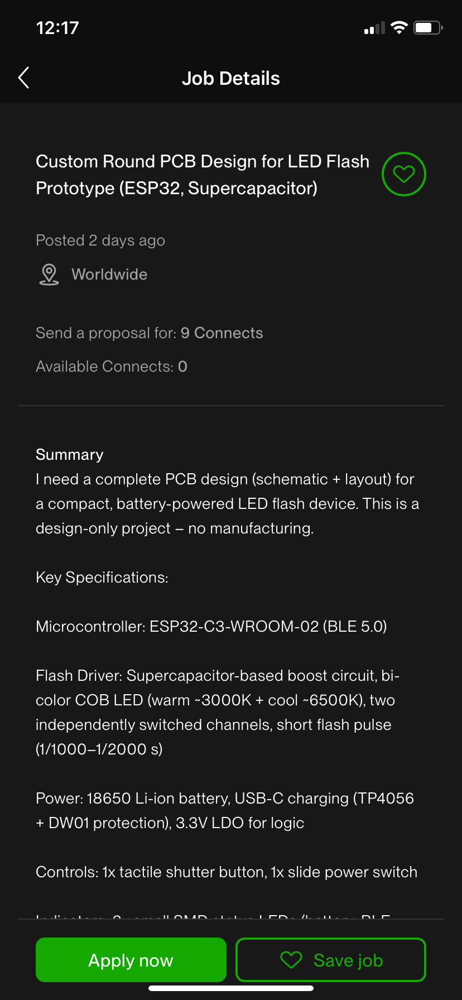
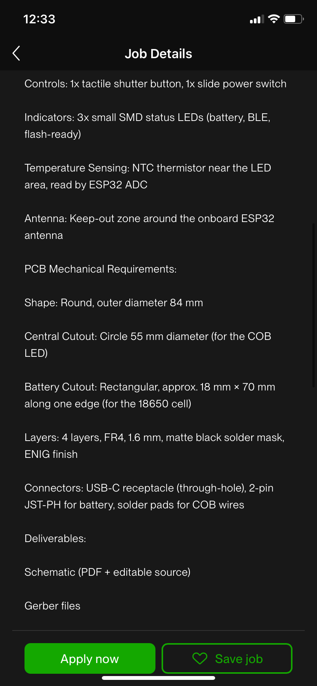
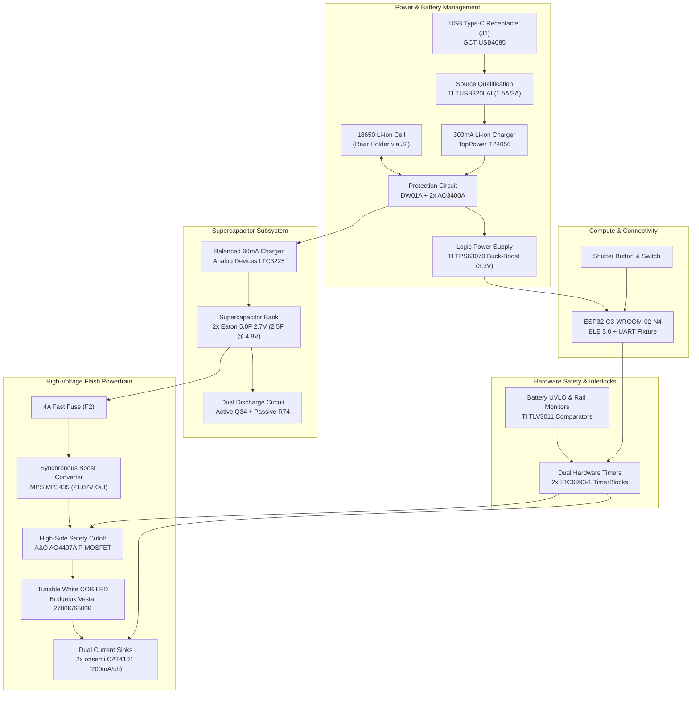

# Round LED Flash — Annular Ring Camera Strobe

[](https://kicad.org)
[](docs/IMPLEMENTATION_STATUS.md)
[](analysis/draft_erc.rpt)
[](analysis/design_envelope.json)

An advanced, hardware-interlocked **annular ring LED camera flash and video light** engineered in **KiCad 10.0.7**. Designed to fit concentric around photographic lens barrels (84.0 mm OD × 55.0 mm ID), the board integrates a **supercapacitor-buffered boost powertrain**, dual regulated current sinks for a tunable white COB, hardware-enforced timing and safety interlocks, and Bluetooth Low Energy (BLE 5.0) control via an **ESP32-C3**.

<p align="center">
  
  
</p>

---

## 1. System Architecture & Powertrain



---

## 2. Technical Specifications

| Parameter | Specification | Notes |
| :--- | :--- | :--- |
| **Dimensions** | 84.0 mm OD × 55.0 mm ID annular ring | 14.5 mm radial circuit corridor, 4 layers, 1.6 mm FR-4 |
| **Microcontroller** | Espressif ESP32-C3-WROOM-02-N4 | 32-bit RISC-V @ 160 MHz, BLE 5.0, 4 MB Flash |
| **Battery Interface** | 1S Li-ion 18650 via JST-PH 2.0 mm | Keyed connector, rear holder mount, DW01A protection |
| **System Logic Rail** | 3.3 V regulated @ 500 mA | TI TPS63070 synchronous buck-boost (continuous 2.7 V to 4.35 V) |
| **Energy Buffer** | 2.5 F effective (2× 5.0 F / 2.7 V Eaton HV1020) | Series configuration; 28.8 J total stored energy @ 4.8 V |
| **Capacitor Charger** | ADI LTC3225 active cell balancer | 60 mA constant-current charging from battery |
| **Flash Boost Converter** | MPS MP3435GL-Z synchronous boost | 4.8 V nominal input to 21.07 V output; 10 mΩ current sense (`R270`) |
| **Current Regulation** | Dual onsemi CAT4101 constant-current sinks | 200 mA nominal per channel (warm / cool independent channels) |
| **Optical Emitter** | Bridgelux Vesta Tunable COB (BXRV-TR-2765G) | Off-board emitter in central aperture on dedicated heat spreader |
| **Pulse Duration** | 500 µs to 1000 µs commanded | Firmware pulses gated inside hardware limit window |
| **Hardware Flash Window**| 1.403 ms nominal (1.449 ms max) non-retriggerable | ADI LTC6993-1 hardware timer prevents stuck-on conditions |
| **Hardware Cooldown** | 1.258 s nominal minimum interval | ADI LTC6993-1 timer locks out re-triggering until safe |
| **Service Discharge** | Active dump FET (`Q34`) + permanent passive bleed (`R74`)| Discharges capacitor bank below 0.5 V in <50 minutes |
| **Sensors & Telemetry** | 2× 10 kΩ NTC thermistors (B=3988 K) | Onboard sensor near inner ring; external cell pack NTC (`J3`) |

---

## 3. Design Verification & Analysis

The design has been verified across multiple automated physical and electrical model passes:

- **Schematic Rules (ERC):** 0 errors, 0 warnings ([analysis/draft_erc.rpt](analysis/draft_erc.rpt)).
- **Schematic-to-Layout Parity:** 0 missing nets, 0 footprint mismatches across all 237 placed PCB footprints ([analysis/core_parity_drc.rpt](analysis/core_parity_drc.rpt)).
- **Design Envelope Physics Models:** All 13 hardware corner calculations pass in [scripts/check_design_envelope.py](scripts/check_design_envelope.py):
  - Cap bleed-down time modeled: ~49.5 min to <0.5 V
  - Unpowered ADC pin leakage modeled: 0.111 V max (<0.3 V limit)
  - Loaded input voltage droop: 3.18 V min (exceeds 3.0 V converter threshold)
  - Peak capacitor pulse draw: 3.88 A (well below 4.46 A limit)
  - Hardware window: 1.403 ms (under 2.0 ms safety ceiling)
  - Hardware cooldown: 1.217 s min (exceeds 1.0 s thermal protection threshold)
  - Dual-threshold cell NTC comparator window (0°C to 45°C) fully inhibits charge outside safety envelope
- **Design Review Document:** Full findings triage and analysis matrix documented in [docs/DESIGN_REVIEW.md](docs/DESIGN_REVIEW.md).

---

## 4. Repository Structure

```
custom-round-pcb-led-flash/
├── Round_LED_Flash.kicad_pro    # KiCad 10 project file
├── Round_LED_Flash.kicad_sch    # Master schematic
├── Round_LED_Flash.kicad_pcb    # 4-layer circular PCB layout
├── Round_LED_Flash.kicad_dru    # Project design rules
├── bom/
│   └── bom.csv                  # Enriched BOM with 100% MPN coverage
├── docs/
│   ├── DESIGN_REVIEW.md         # Comprehensive engineering review & triage
│   ├── SYSTEM_ARCHITECTURE.md   # Architectural design baseline & requirements
│   ├── IMPLEMENTATION_STATUS.md # Implementation state & engineering decisions
│   └── BRING_UP_AND_QUALIFICATION.md # Prototype test procedures
├── output/
│   └── pdf/
│       └── Round_LED_Flash_Schematic.pdf # Vector schematic drawing
├── scripts/
│   ├── check_design_envelope.py # 13-point mathematical boundary validation
│   └── select_bom.py            # BOM property assignment and enrichment
└── libraries/                   # Project-specific symbol & footprint libraries
```

---

## 5. Prototype Status & Next Steps

This project is released as a **Rev A Prototype Design Candidate**. All schematics, BOM parts, component footprints, and hardware safety mechanisms are fully scoped and verified against manufacturer specifications. 

Physical assembly and bench bring-up tests (startup rail sweeps, capacitor ESR droop under load, optical pulse duration measurements, and near-field EMC scans) are detailed in [docs/BRING_UP_AND_QUALIFICATION.md](docs/BRING_UP_AND_QUALIFICATION.md).
