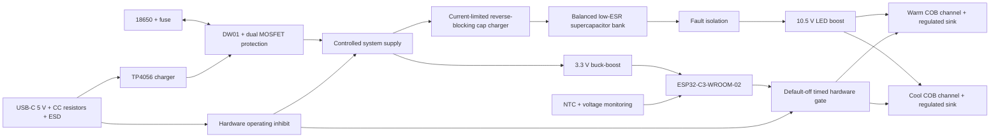

# Round LED Flash — system architecture

Architecture baseline, 2026-10-20. Status: ready for detailed engineering; NOT fabrication released.

Implementation has started. Read `IMPLEMENTATION_STATUS.md` for current state and superseding component findings. In particular, the real COB candidate needs a higher-voltage driver, and the placed draft capacitor bank is 5 F rather than the provisional 0.5 F below. Neither the original provisional envelope nor the current partial project is a frozen electrical design.

## Purpose and source

Create one KiCad 10 project demonstrating professional schematic design, constrained PCB layout, design verification, and manufacturing documentation. Source brief: `client_request/IMG_7281.PNG`, `IMG_7282.PNG`, and `IMG_7283.PNG`, read visually. The brief is design-only; physical assembly and measurements are subsequent validation, not completed work.

This document separates client requirements from engineering assumptions. Assumptions authorize progress, but do not constitute verified component performance. No exact COB, supercapacitor, battery, or enclosure was specified.

## Requirements and disposition

| ID | Client requirement | Architecture disposition |
|---|---|---|
| R01 | ESP32-C3-WROOM-02, BLE 5 | Retain module with PCB antenna; reserve programming/reset access |
| R02 | Supercapacitor-based boost flash | Protected cell slowly charges low-voltage capacitor bank; bank feeds LED boost |
| R03 | Warm ~3000 K and cool ~6500 K COB | Two independently regulated current sinks; select a compatible dual-channel COB before schematic freeze |
| R04 | 1/1000–1/2000 second flashes | 0.5–1.0 ms commanded pulses; hardware maximum-duration gate and default-off outputs |
| R05 | 18650, USB-C, TP4056 + DW01 | Retain charger/protector topology subject to exact manufacturer datasheets; charging-only USB; operation inhibited during charging |
| R06 | 3.3 V LDO | Deliberate departure: use buck-boost to maintain 3.3 V across cell discharge |
| R07 | Shutter and slide power switch | Retain; slide switch controls enable circuitry, not high-current flash path |
| R08 | Battery, BLE, ready indicators | Three LEDs; battery LED indicates charging/charged status, BLE and ready under MCU control |
| R09 | NTC near LED, ADC readout | Retain near inner board edge; detect open/short sensor; acknowledge thermal lag to remote COB |
| R10 | Antenna keepout | Explicit all-copper-layer rule area and component/mechanical keepout per module guidance |
| R11 | 84 mm OD, 55 mm central opening | Retain as baseline |
| R12 | ~18 × 70 mm battery cutout along edge | Departure: battery in rear enclosure cradle, wired via JST-PH; omit conflicting cutout |
| R13 | Four layers, FR4 1.6 mm, matte black, ENIG | Retain; final stackup and mask availability confirmed with selected manufacturer |
| R14 | Through-hole USB-C, JST-PH 2 pin, COB solder pads | Select actual connector before footprints; prefer true THT signal pins if available, otherwise disclose hybrid SMT contacts/THT anchors as another departure |
| R15 | Editable schematic, PDF, Gerbers, BOM, centroid | Generate all from the single authoritative project after checks |

## Mechanical feasibility decision

The ring has radial width (84−55)/2 = **14.5 mm** and gross area π(42²−27.5²) = **3165.94 mm²**, before courtyards, edge clearances, antenna space, and mounting features.

An 18 mm radial-width battery rectangle cannot lie in that 14.5 mm band without intersecting the central opening or outer perimeter. The 70 mm length makes the conflict stronger: at y=27.5 mm, the outer circle has only 2√(42²−27.5²) = **63.49 mm** chord length. A centered 70 mm tangent rectangle with its inner edge outside the LED opening cannot fit. An edge-connected slot could remove a large part of the ring, but that is a different mechanical design requiring enclosure support and explicit topology review.

Baseline: keep the complete annulus, mount cell behind it on insulated mechanical supports, and route battery wires away from antenna and COB heatsink. Battery body, leads, holder, and insertion access must be included in the 3D clearance check. Do not assume a nominal 18 mm diameter is a usable holder clearance. Mounting-hole coordinates remain to be chosen during floorplanning; reserve three distributed support regions outside antenna and power clusters.

The COB sits in the central opening on an independent metal heat spreader. FR4 ring is not its primary heatsink. A module or connector may overhang the board edge only if documented in the assembly envelope. The 84 mm specification applies to PCB diameter; enclosure outer diameter is unspecified.

## Selected topology

USB charging, battery protection, and system grounding must be drawn from actual pin-level reference circuits. For low-side DW01 protection, cell negative and protected system ground are distinct nets. Connect USB/system returns to the protected side; no programming fixture, shield, cap return, or test lead may bypass protection. Label both negative terminals explicitly.

### Power and charging

- Cell: conventional 1S 4.2 V maximum Li-ion; preliminary usable operating range 3.3–4.2 V. Firmware low-battery cutoff is above the protector's emergency cutoff. Exact threshold tolerance and hysteresis must be calculated.
- USB-C: 5 V sink, separate nominal 5.1 kΩ Rd on CC1 and CC2, VBUS protection and local capacitance. No USB PD. No MCU USB data in baseline; program by 3.3 V UART pogo pads.
- Charge current: provisional **80 mA**, with total worst-case USB draw below 100 mA including tolerances and indicator current. This deliberately trades charging speed for a simple low-power input; check the applicable USB Type-C default-current rules and charger minimum programmable current before freeze. For practical faster charging, add verified source-current detection and configure charge current accordingly; never assume Rd alone authorizes 1.5 A.
- VBUS presence hardware-disables normal operation and capacitor charging. This avoids uncontrolled system load interfering with TP4056 charge termination. The small always-connected leakage load still needs accounting against termination current. USB insertion must terminate an active pulse safely.
- The charge path remains functional with slide switch off. The switch, VBUS inhibit, and power-good logic must force both LED sinks off independently of firmware.
- Protection includes exact DW01 variant, suitable back-to-back MOSFETs, cell fuse, and a keyed battery connector with marked polarity. Overcurrent thresholds must tolerate the intended load yet protect connector and wiring. JST-PH carries recharge and logic current, not the capacitor's local flash loop.
- Logic: 3.3 V buck-boost, provisional TPS63070, sized for at least 500 mA output over the full battery range and transient load. Its switch rating is not an output-current guarantee. Use datasheet reference layout and verified component calculations.

### Flash energy and current

**Provisional LED envelope:** each channel Vf = 8–9.5 V at 350 mA; both may fire simultaneously. This is a procurement constraint, not a claim about the unspecified COB. Choose a real warm/cool COB matching this envelope, including common-anode or isolated wiring compatibility. If none is suitable, revise boost voltage and calculations before schematic work; do not substitute a 24–36 V COB into this design.

Boost output target: 10.5 V. Candidate TPS61088; exact suffix, compensation, UVLO, inductor, input/output caps, and fault behavior remain to be verified from a downloaded datasheet. Budget **0.7 A output**, **7.35 W peak**, and **8.65 W input** at an assumed conservative 85% efficiency. At 3.3 V this is **2.62 A** before wiring/ESR effects. Set a preliminary 4 A design envelope for capacitor/boost interconnects and verify peak inductor current separately.

For a 1 ms pulse, boost energy = 7.35 mJ; capacitor energy demand ≈ 8.65 mJ. With 0.5 F effective bank capacitance at 3.3 V, ideal energy droop is only about **5.25 mV**. At 2.62 A and 100 mΩ total bank ESR, instantaneous droop is approximately **262 mV**, showing that ESR and converter dynamics dominate capacitance. Recalculate self-consistently at the sagged input voltage; this first-order estimate is not final proof of margin. Target bank ESR ≤100 mΩ over specified temperature and age, and use local ceramics for switching currents.

Baseline capacitor bank: two nominal 1 F, ≥2.7 V low-ESR cells in series, 0.5 F effective, charged no higher than protected battery voltage. Both cells require balancing and overvoltage assessment during startup, leakage mismatch, temperature variation, and aging. Select active balancing or a rated integrated module if resistor balancing cannot demonstrate per-cell margin. Memory-backup high-ESR capacitors are unsuitable. Reserve physical volume before placement; these parts can dominate the annulus.

Cap charger: current-limited to about 100 mA, reverse-blocking, short-circuit tolerant, and safe under continuous charging from zero volts. Ideal cold-charge time to 4.2 V is C·V/I ≈ **21 seconds**; practical charge time will be longer. Check thermal SOA of a linear limiter at startup (~0.42 W initial loss). Stop recharge during each flash to isolate the battery load. Never connect an empty bank directly to the cell.

Do not treat boost EN as a physical disconnect. Provide a verified isolation path and controlled discharge/service procedure; stored energy at 4.2 V is **4.41 J**. Off-state leakage, backfeed into dead logic, LED fault paths, and cap-discharge time require explicit review.

Each channel uses a closed-loop constant-current sink with a Kelvin-connected sense resistor. Nominal 100 mV sense would require R=0.1/0.35 ≈ **0.286 Ω**, dissipating **35 mW during the pulse**. This is a design target, not a final resistor or control-IC selection. Choose a sink controller or op-amp/MOSFET circuit with verified startup settling, compliance, stability, and pulse SOA. MOSFET RDS(on) alone does not establish linear-mode suitability. At 8 V LED Vf, sink dissipation is roughly 0.875 W while on; protect against continuous-on faults.

Keep boost precharged while armed; initiate pulses through sink gates rather than converter startup. Verify output transient capacitance: if the output capacitors alone supplied 0.7 A for the entire 1 ms with ≤0.5 V droop, at least 1400 µF effective would be needed. Therefore the planned compact design depends on the running converter responding during the pulse. Size effective output capacitance using simulation and bench measurements, not energy-bank capacitance alone.

Normal pulse width: 500–1000 µs; initial repetition limit: 1 Hz. Hardware non-retriggerable time limit ≤2 ms at worst-case tolerance, plus a minimum re-arm interval or latch requiring a new valid arm sequence. A timer that can be kept active by repeated triggers is insufficient. Hardware gate combines power-good, cap-ready/UVLO, USB absence, and master enable. MCU reset/high-impedance pins must never produce a flash. Thermal limits and readiness remain necessary even at low duty cycle.

This is a modest proof-of-function electrical baseline. No photographic exposure, luminous flux, CRI, or commercial flash equivalence is claimed. Those require a selected emitter and optical measurements.

## Control allocation and behavior

Reserve GPIO0/1/3 for battery, cap-bank voltage, and NTC ADC measurements; GPIO4/5 for warm/cool requests; GPIO6 for cap-charge/arm control; GPIO7 for ready/fault input; GPIO10 for shutter; GPIO18/19 for BLE/ready LEDs; GPIO20/21 for UART RX/TX. This is a preliminary allocation to verify against the module pin table and firmware peripheral needs. GPIO2/8/9 are boot-strapping pins: keep unavailable to ordinary loads unless reviewed explicitly. Provide BOOT and EN access at test pads. Battery LED is driven by charge-status circuitry. If separate boost-voltage telemetry or additional fault signals are needed, add an ADC mux or shared hardware-ready comparator rather than silently consuming boot pins.

State sequence: OFF → SELF-TEST → CAP CHARGE → BOOST PRECHARGE → READY → FLASH → RECOVER. Any undervoltage, sensor fault, excessive temperature, USB insertion, timeout, or reset forces a non-flashing state. BLE sends commands; local hardware timers generate the pulse. BLE latency is not camera synchronization accuracy. Debounce shutter and require release before accepting another press.

Provide test points for protected battery, cell negative (clearly marked), protected ground, 3V3, cap midpoint, cap bank, boost output, both sense voltages, hardware gate, EN, BOOT, and UART. Dividers and NTC networks must not overdrive ADC inputs or back-power an unpowered MCU. NTC near the board opening monitors local temperature, not instantaneous COB junction temperature; retain emitter pulse limits and heatsink design independently.

## PCB floorplan and routing contract

- Start with a footprint-only mechanical feasibility pass before schematic freeze. Verify module, antenna keepout, cap bank, inductors, connectors, mounting points, and enclosure space simultaneously.
- Four-layer baseline: F.Cu components/short critical loops; In1.Cu continuous protected GND except intentional antenna keepout; In2.Cu power distribution with ground where appropriate; B.Cu low-speed signals and local ground. Keep high-current loops local on outer copper rather than circulating around the ring.
- Place ESP32 at outer rim with antenna directed outward, following manufacturer clearance. Keep the rear cell, metal heatsink, fasteners, USB shell, and wires out of its antenna volume. A ground plane below the RF module body is useful; no copper belongs in the antenna keepout.
- Place cap bank, boost input caps, inductor, switch node, output caps, sinks, and COB solder pads as one compact sector. USB/charger and battery connector occupy another sector; logic regulator and MCU occupy the RF sector. Final coordinates follow actual footprints, not this conceptual partition.
- Route boost and buck-boost switching loops, sense Kelvin traces, flash current paths, and local returns deliberately. Minimize switch-node copper; keep it away from ADC and antenna. Use a common ground system with placement-controlled returns, not gratuitous split planes.
- Initial manufacturable rules: 0.20 mm ordinary trace/clearance, 0.60/0.30 mm via diameter/drill, 0.50 mm copper-to-routed-edge clearance on both contours. These are chosen targets, not quoted fabricator limits. Select trace/pour widths and via arrays from current, copper thickness, temperature rise, and pulse duty; do not use a universal width for power.
- Prefer 0603 or larger passives where space permits, assembly-accessible test pads, legible polarity labels, three fiducials per populated side, and no untented open vias in solder pads unless the fabrication process supports them.
- Use pcbnew from KiCad 10 for repeatable geometry, placement, net assignment, and rule areas after a small API compatibility check. Preserve schematic UUID links and schematic-to-PCB consistency.
- KiCadRoutingTools may route remaining ordinary signals after critical traces are protected. Pin a tested version. Prevent tools from weakening project rules or moving fixed mechanical parts. Refill zones and run native KiCad DRC after every accepted routing change. Router success is not electrical verification.

## One authoritative project

Use root basename `Round_LED_Flash` with exactly one authoritative `.kicad_sch`, `.kicad_pcb`, and `.kicad_pro`. These are modern KiCad extensions, not legacy `.sch`/`.pro` or generic `.pcb`. Use one schematic sheet, logically grouped and readable at a suitable page size. Custom symbol/footprint libraries and `.kicad_dru` are supporting assets, not duplicate projects.

Keep documents under `docs/`, manufacturer PDFs under `datasheets/`, analysis under `analysis/`, and generated exports under `manufacturing/`. Use version control for history rather than `_final2`, `_routed`, or `_backup` project copies. Preserve existing user work if any appears. Router scratch files must not become competing deliverables.

BOM source of truth is the schematic: Manufacturer, MPN, Datasheet, footprint, population status, and sourcing properties. Exact parts are not yet selected or stock-checked.

## Release gates and portfolio evidence

1. Close component/mechanical feasibility: actual COB, cell/holder, low-ESR capacitor bank, connectors, hardware timer/current-sink design, cap balancing, and enclosure clearance. Revisit this architecture if parts fail its envelope.
2. Verify every critical symbol pin and footprint pad against manufacturer documents; calculate converter margins, passive tolerances, derating, startup, fault states, and thermal losses.
3. Complete schematic ERC and native schematic/PCB connectivity cross-check. Resolve every error and explain intentional exceptions without suppressing unknown failures.
4. Finish layout and filled zones; native DRC has no unconnected nets or unexplained violations. Inspect both copper layers and all-layer antenna keepout visually, including actual filled copper.
5. Run applicable kicad-happy schematic/PCB/cross-domain, thermal, EMC, and Gerber checks. Run SPICE when a simulator is installed. Triage findings against raw files and datasheets. Record skipped checks and confidence explicitly.
6. Inspect exported schematic PDF, Gerbers, routed inner cutout, plated/nonplated drills, BOM, centroid side/rotation conventions, assembly drawing, and 3D mechanical envelope. Confirm fabricator stackup and panel/handling needs for the annulus.
7. Call the result **fabrication-ready design** only after those checks. Call it **hardware validated** only after actual bring-up: charging/protection, cap startup and imbalance, rail transients, current and optical pulse waveform, thermal behavior, BLE operation, and fault injection.

Portfolio package should show requirement traceability, documented departures, readable schematic, annotated stackup/floorplan, critical current-loop diagrams, layout/3D images, evidence-based review, and a bring-up plan. Later add actual oscilloscope captures and board photos. Do not describe renders or simulated waveforms as measured hardware. Prepare public text independently of client screenshots; do not publish client identity or source screenshots without rights to do so. No portfolio upload is performed at this stage.

## Source register and confidence

- Client screenshots: direct visual evidence for requirements; no emitter datasheet supplied.
- Local `kicad-cli version`: **10.0.7**; KiCad Python executable present. pcbnew import and routing installation not tested in this phase.
- Espressif module datasheet v1.7: https://www.espressif.com/sites/default/files/documentation/esp32-c3-wroom-02_datasheet_en.pdf — supply range and 500 mA source requirement inspected. Pin assignment still needs full implementation verification.
- Espressif PCB guide: https://docs.espressif.com/projects/esp-hardware-design-guidelines/en/latest/esp32c3/pcb-layout-design.html — grounding/placement guidance.
- TPS63070: https://www.ti.com/product/TPS63070 — topology/range candidate evidence; not a completed design calculation.
- TPS61088: https://www.ti.com/product/TPS61088 — candidate boost range found in manufacturer search results. Direct datasheet fetch failed during architecture research; must retrieve and verify before use.
- Router: https://github.com/drandyhaas/KiCadRoutingTools — README states KiCad 9/10 support and Windows binaries; local compatibility untested.

Trust summary: client requirements directly read; geometry and first-order energy calculations analytical; topology and numerical targets engineering assumptions; component pin-level verification, sourcing, simulation, ERC/DRC, and manufacturing review pending. This is an architecture decision record, not a completed design review.

